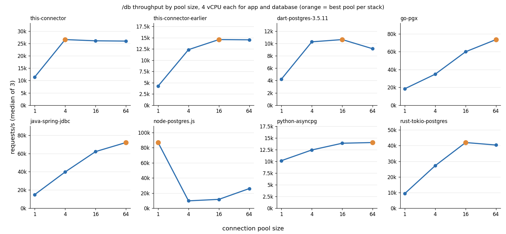

# Connection pool size sweep, HTTP `/db`

Does a bigger connection pool mean more throughput? Eight HTTP back-end stacks served the same endpoint
with pools of 1, 4, 16 and 64 connections, on the same machine and under the same CPU limits.

## Result

Requests per second, median of 3 runs per cell; the best pool of each stack in bold. Raw data:
[`pool-size-sweep.csv`](pool-size-sweep.csv).

| Stack | pool 1 | pool 4 | pool 16 | pool 64 |
|---|---:|---:|---:|---:|
| this-connector | 11,432 | **26,592** | 26,093 | 25,981 |
| this-connector-earlier | 4,251 | 12,354 | **14,595** | 14,542 |
| dart-postgres-3.5.11 | 4,234 | 10,272 | **10,637** | 9,151 |
| go-pgx | 18,441 | 34,781 | 59,934 | **73,572** |
| java-spring-jdbc | 14,923 | 39,724 | 62,067 | **71,998** |
| node-postgres.js | **86,881** | 9,707 | 11,681 | 25,976 |
| python-asyncpg | 10,164 | 12,452 | 13,891 | **14,039** |
| rust-tokio-postgres | 9,355 | 27,170 | **41,975** | 40,381 |



## Reading it

There is no single right pool size: each stack has its own optimum.

- **Still climbing at 64:** Go, Java and Python. A later extension to 128 and 256 connections, on the same
  machine, added only +2.3% for Go and +1.7% for Java, against +22.8% and +16.0% from 16 to 64, so 64 was
  already their practical optimum.
- **Peak at 16, then a small drop:** Rust, the pure-Dart package and the earlier version of this connector.
- **Flat from 4:** this connector reaches its plateau at 4 connections and stays there up to 64 (26,592 to
  25,981, −2.3%). In this range it is not limited by connection concurrency; adding connections buys
  nothing.
- **Best with one connection:** Node with postgres.js. Its curve is not monotonic (it recovers from 4 to
  64), and the cause has not been isolated.

`this-connector-earlier` is the same connector before a non-transactional fast path for single reads; it
shows the same curve shape at a lower level.

## Setup

- **Hardware:** MacBook Air M4 (fanless), 10 cores, 16 GB, macOS 15.7.5; Docker Desktop with a 12-vCPU VM.
- **Database:** PostgreSQL 16 (`postgres:16-alpine`), TechEmpower schema; `/db` reads one random row of
  `world` (10,000 rows) per request. A check against `pg_stat_statements` confirmed that every request
  reached the database.
- **Limits:** 4 vCPU for the application container **and** 4 vCPU for the database container.
- **Load:** `wrk`, 20 s warm-up discarded, 45 s measured.
- **Stacks:** this connector (current and earlier version) and `postgres` 3.5.11, both behind the same Dart
  HTTP server; Go with pgx; Java with Spring Boot JDBC; Node with Fastify and postgres.js; Python with
  uvicorn and asyncpg; Rust with axum, tokio-postgres and deadpool-postgres.
- **Host:** measured overnight on 2026-08-15, with macOS background indexing daemons suspended and host load
  recorded alongside; a first attempt contaminated by those daemons was discarded.

## Reproduce

The overnight orchestrator used for this battery is not part of this repository. The closest reproduction
with the scripts here, from `benchmarks/docker`:

```bash
docker compose -f compose.postgres.yml build
bash run-http-postgres.sh --endpoints db --topologies 1,4,16,64 --vcpus 4 --sessions 3
```

It runs the same stacks, endpoint and pool sizes with the same isolation per cell, but does not suspend the
host daemons or record host load for you; see the host-load section of the
[benchmark README](../README.md).

## Caveats

- **One machine.** Absolute throughput of stacks that saturate the host does not transfer to other
  hardware. What this battery supports is the shape of each curve and comparisons inside the same window.
- **The database gets the same CPU as the application.** At their optimum, Go and Rust drive the database
  container close to its 4-vCPU ceiling; with 8 vCPU for the database, Go gained +25.0% and Rust +12.0%,
  while Java did not move. The numbers above are conditional on equal quotas.
- **Open-loop load generator** (`wrk`), so these runs say nothing reliable about p99; they are about
  throughput only.
- **Only PostgreSQL 16, only `/db`.** Endpoints with more queries per request may have different optima.
- **Eight cells** were flagged by the host-load covariate after a re-run; they are reported, not removed.
